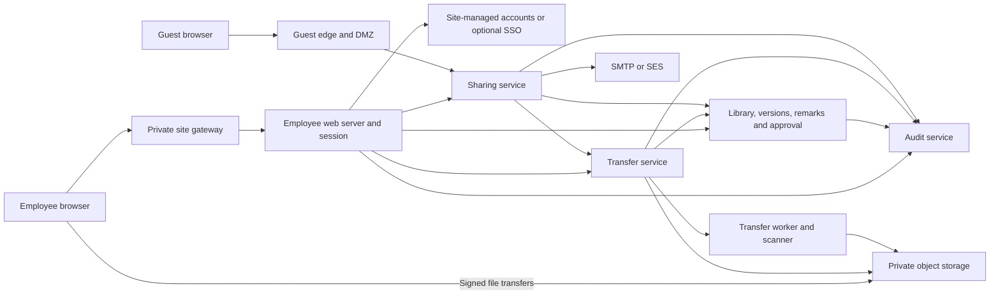

# PlantDocket System Architecture

**Working baseline · 23 November 2026**

The MVP is a factory document control website for floor plans, electrical and panel diagrams, engineering designs, HR policies and office documents. The core record is an immutable document revision with remarks and departmental decisions. The effective approved copy changes only after its final required approval. A separate guest origin serves specifically invited approved revisions. The same web and Go workloads run in either installation profile.

The attached reference diagrams supply the long-term capability inventory and domain boundaries. This plan sets the service boundaries, release order, and deployment profiles for implementation. The initial sizing basis remains 10 employees, 20 invited recipients, three concurrent uploads, 500 MB per file, 50 GB starting storage, and 10 GB monthly net growth.

## System boundaries

| Boundary | Owns | Deployable and storage |
| --- | --- | --- |
| Gateway | TLS, routing, request size policy, rate limits, correlation IDs, and exposure by hostname | Customer proxy locally/on-site, AWS ALB and edge policy in AWS |
| Employee web | Private workspace, named-user sign-in, server-held session and same-origin forwarding of allowed API requests | Independent web deployment with scoped session state |
| Library | Memberships, folders, immutable revisions, remarks, approval templates and decisions, effective revision, quotas, authorization and trash | Go service and its PostgreSQL database. Final approval, effective pointer and audit outbox commit together. |
| Transfer | Resumable upload sessions, multipart state, object verification and signing, quarantine, scan/draft-registration jobs, and storage reconciliation | Go API and Go worker with ClamAV. They share the Transfer database and hold separate storage roles. |
| Sharing | Guest grants, hashed invitation tokens, emailed OTP challenges, guest sessions, revocation, and guest download delivery | Go service and its PostgreSQL database. It serves a small server-rendered guest page. |
| Audit | Durable, deduplicated events, authorized export, and verification of retained archive batches | Go service and its PostgreSQL database or archive projection. Archive writes use separate credentials. |
| Account authority | Named people and current authentication status | Site-managed accounts as the baseline, with customer SSO when selected |

One PostgreSQL server can host separate databases in the initial profile. Each service uses its own credentials and migrations and reads other service data through contracts. Workers can run with several replicas while preserving lease ownership. The proposed GitHub repositories are `plantdocket-web` and `plantdocket-backend`. The backend publishes versioned OpenAPI and the web repo pins the compatible contract. Build and version artifacts independently and test the combined release manifest. See the [backend delivery plan](../mvp/06-backend-delivery.md) and [GitHub naming](../prds/01-product-positioning.md).

## End-to-end flows

1. **Identity and authorization.** The employee website opens a named-user session using the configured account mode. Browser API traffic reaches private services through the same-origin web boundary. Library enforces workspace, document and review-step permissions. Guest routes are limited to approved invitations.
2. **Upload.** Transfer asks Library to authorize the folder, assign a candidate version and reserve quota. Transfer creates multipart upload and short-lived part URLs. The browser sends parts directly to the approved object origin, records progress and relists confirmed parts after an interruption. Transfer alone completes multipart upload. It commits the immutable staging locator, verified byte count and one scan job together. [Amazon S3 multipart uploads](https://docs.aws.amazon.com/AmazonS3/latest/userguide/mpuoverview.html).
3. **Scan and register.** The worker verifies exact bytes and scans the pinned object. Library commits one immutable draft, quota charge and outbox event. The effective approved pointer stays unchanged during scanning, holds and draft registration.
4. **Remark, review and approve.** Contributors and reviewers attach remarks to the document or revision. Library binds each submission to its exact bytes and department template. Intermediate approvals advance the review. The final required approval commits the effective pointer and supersession with the decision and audit event. A returned revision and its reasons stay in history.
5. **Controlled retrieval.** Ordinary staff get the effective approved revision. Authorized contributors and reviewers can inspect eligible clean drafts, and scoped historical readers can retrieve superseded approved copies. Restoring historical bytes creates a new draft. Transfer signs exact-version access only after a Library decision.
6. **Guest download.** Sharing rechecks final approval and permission when a grant is created and before each full or range request. The invited email verifies by code. Guests receive the pinned approved revision without internal remarks or approval history.
7. **Audit and repair.** A committed business change writes an outbox event with stable identifiers. Audit deduplicates delivery and archives evidence. Operators verify that restored documents retain exact bytes, remarks, decisions and the effective revision.

## Enterprise guardrails

- External contracts are versioned REST/OpenAPI. Internal calls have scoped service identity, bounded deadlines, correlation IDs, and explicit retry policies. Mutations that can retry have idempotency keys and distinguish conflicts from transient failures.
- Workspace IDs appear in every data access and event. Principal IDs derive from issuer and subject. Logical object keys are opaque and immutable across providers. Session tokens, codes, signed URLs, and document contents stay out of logs.
- Use TLS at ingress and between trust zones, role separation, encryption at rest, isolated quarantine, a default-deny guest edge, and separately administered backups. Analyze required service-to-service mTLS, retention, and key custody per customer before release.
- Standardize structured logs, OpenTelemetry traces, request error rates, scan and outbox lag, object capacity, email delivery, and restore evidence. Preserve workspace and request context with a privacy-aware audit schema.
- Ship signed OCI images, a software bill of materials, versioned contracts and migrations, and compatible release manifests. Promote a tested image digest through deployment profiles. Signed instructions and backup/restore runbooks are part of the installable release.

## Topology and scope progression

| Stage | Runtime | Gate |
| --- | --- | --- |
| Local | Web server, container stack, disposable databases, object storage, test accounts and mail sink | Test the document change and approval journey, approved guest download and failure fixtures |
| Staging | Dedicated PostgreSQL instance, storage, network/identity, and approved mail. Use the same image digests as the release candidate. | Contract, feature, migration and rollback evidence. Exercise recovery before launch. |
| On-site primary | Customer site gateway and guest DMZ, customer host or VMs, approved data services and backup outside the site | Validate employee and guest routes, a clean install and isolated restore |
| Off-site primary | Dedicated customer or provider infrastructure at an approved remote facility, private employee access, guest edge, independently retained backups | Validate remote employee and guest routes, facility ownership, a clean install and isolated restore |
| Enterprise HA and passive recovery | Independent fault domains, supported HA PostgreSQL and object storage, resilient edge, and tested passive recovery where required | Component and site failures within agreed recovery objectives |
| AWS scale | AWS ALB/WAF, ECS Fargate, RDS, S3, SES and regional recovery. EKS where the operating model requires Kubernetes. | Regions, load, isolation, commercial and recovery commitments verified |

See the [MVP PRD](../prds/02-onsite-mvp-prd.md), [shared service contracts](../specs/00-service-contracts.md), [release gates](../delivery/02-ci-cd-and-release-gates.md), [post-MVP roadmap](../mvp/03-post-mvp-roadmap.md), [installation architectures](04-deployment-architecture.md), and [cost model](../costing/07-cost-model.md).
