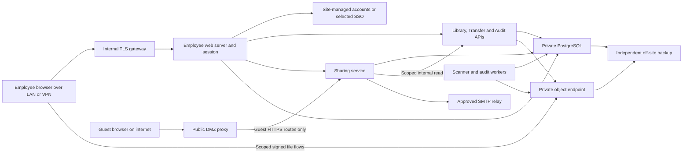
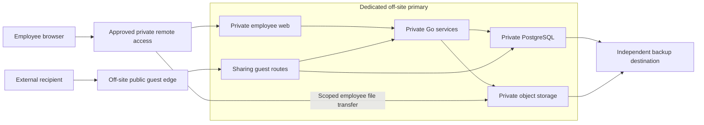
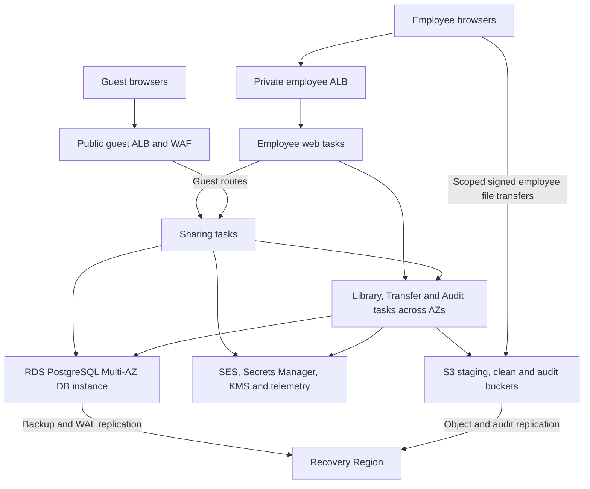

# PlantDocket Deployment Architecture

## Deployment profiles

| Profile | Topology and capacity basis | Release evidence |
| --- | --- | --- |
| Local | Developer machine with 4–8 vCPU available, 16 GiB RAM and 80 GiB free SSD as a starting allocation. Container stack for web, gateway, services, PostgreSQL, S3-compatible object store, scanner, test accounts and mail sink. | Exercise employee and guest origins with supported browsers, synthetic files and test identities. |
| Staging | Separate PostgreSQL instance, storage, network, identity and mail. Use a dedicated VM or equivalent isolated compute, initially estimated at 8 vCPU and 32 GiB RAM. | Feature verification, signed image promotion, safe migration, rollback and restore. |
| On-site primary | Customer VM or Linux host with 8 vCPU, 32 GiB RAM, 100 GiB SSD for OS/DB/scratch, plus a separate object volume or service with at least 355 GB usable. One private workload host and a separately controlled public guest edge. | Customer-approved traffic paths, independent backup destination, capacity test, clean-install test and isolated restore. |
| Off-site primary | Same signed Docker Compose release in a dedicated environment at an approved remote facility. Start with equivalent compute and usable storage. Provide private employee connectivity and a separate guest edge. | Remote employee and guest paths, hosting and incident ownership, independent backup destination, clean-install test and isolated restore. |
| On-site HA | Customer-supported Kubernetes or VMs. Start with three independent failure domains, redundant ingress, replicated PostgreSQL and supported HA object storage. Initial compact compute planning model is three hosts with 16 vCPU and 64 GiB RAM per host, plus separately sized storage. | Loss of one failure domain, upgrades, restore and support drills under load. |
| Independent backup and recovery | Approved location independent of the selected primary, with separated credentials and recoverable keys. Restore to an isolated target. A contracted warm standby adds a ready runtime and replication. | Recover encrypted backups after primary loss and measure data age and service recovery. |
| AWS scale | ECS in private subnets across two or more AZs, ALB with public or internal entry points, RDS PostgreSQL Multi-AZ DB instance, S3, and SES. Start with geographically appropriate Regions. Prebuild regional recovery where required. | Performance, interoperability, security, disaster recovery, operating cost, and ownership verified. |

All allocations are engineering estimates for the stated MVP traffic. Validate them under scanner signature reload, disk/backup contention, and guest streaming. See the [cost model](../costing/07-cost-model.md) for the object-retention calculation and cost inputs.

## Local installation

Run a Compose deployment with the employee web application, distinct guest and object origins, test named accounts, mail sink, object-store fixtures and test certificates. Use a browser-reachable hostname for each required endpoint. Use the same API routes and configuration schema across environments. Verify local account sign-in, TLS trust, session scope and exact storage origins. Verify SSO callbacks when that mode is selected. [Amazon S3 CORS configuration](https://docs.aws.amazon.com/AmazonS3/latest/userguide/ManageCorsUsing.html).

Use the [Docker deployment profiles](../delivery/03-docker-deployment.md) for local, CI, staging and the connected MVP. The [staging runbook](../delivery/01-production-to-staging.md) establishes a second environment alongside the current live site. The [Kubernetes deployment profile](../delivery/04-kubernetes-deployment.md) covers development clusters and distributed-node qualification.

Each customer installation chooses a primary location. An off-site primary serves the live website and owns its application data. An independent recovery destination protects either choice. Use the same images and business workflows in both hosting profiles. Site values set routes, policies, identity, storage and operators.

## On-site primary installation

| Route or dependency | Operating policy |
| --- | --- |
| Employee gateway | Private DNS and customer-issued TLS. Reach from approved browsers over LAN, VPN or approved remote connectivity. Route the workspace and same-origin API paths to the web service. Configure customer IdP routes and callbacks only if SSO is selected. |
| Guest edge | Public HTTPS on a separate hostname and customer-controlled DMZ proxy. Allow only invitation, code, and download paths to Sharing. Apply request limits, segmented routing, and monitoring. Sanitize forwarded identity and routing headers. |
| Object endpoint | Internal hostname reachable by employee browsers for scoped signed operations. Configure exact allowed employee origin, methods and exposed part receipts. Sharing streams guest downloads behind the guest origin. Test signer hostname, browser DNS/TLS, cross-origin upload and supported range behavior. |
| Private services | Bind DB, backups, admin, workers and interservice routes to permitted networks. Use separate service identities and account roles. |
| Outbound | Allow approved SMTP, scanner signature mirror, backup and telemetry. Add customer IdP discovery and signing-key routes when SSO is selected. Provide local DNS, time and CA trust. |

Install in order. Confirm rack or hypervisor assignment, VLANs, DNS, certificates, firewall, employee remote access and DMZ. Select a supported S3-compatible endpoint and test multipart, cross-origin upload, immutable identity, encrypted storage, ranges and signed URLs. Import signed web and service images, create isolated service databases and session state, run migrations, configure site identity and mail, and start workloads. Verify both browser entry points, record a backup and restore report, and test upgrade and rollback before handover.

The initial profile accepts host-level interruption. Where the customer requires availability during component failure, deploy paired edge proxies or a customer load balancer VIP, place services across hosts with readiness and graceful draining, and validate HA PostgreSQL and object-storage quorum. Keep operational dashboards visible during a host loss. Use a maintained Gateway API implementation if using Kubernetes. Evaluate the customer-supported storage appliance or Ceph RGW and verify each required behavior on the selected release. [RKE2 HA](https://documentation.suse.com/cloudnative/rke2/latest/en/install/ha.html), [Kubernetes Gateway API implementations](https://gateway-api.sigs.k8s.io/implementations/), [Ceph S3 API](https://docs.ceph.com/en/latest/radosgw/s3/).

A disconnected future profile needs local identity, DNS, NTP, certificates, registry, malware signature import, alerts and backup target. Deliver a signed offline bundle and verify install and upgrade without outbound access. Internet guests require a connected boundary or a separate connected installation. [RKE2 air-gap installation](https://documentation.suse.com/cloudnative/rke2/latest/en/install/airgap.html).

## Off-site primary installation

Install the same release in a customer-approved remote facility or a dedicated hosted environment. Allocate a private segment for the web workload, Go services, PostgreSQL and object endpoint. Use the customer gateway or approved private remote-access service for employee browsers. Apply a separate public guest hostname for the Sharing routes and permit only approved outbound mail, signature updates, backups and telemetry, plus IdP routes when SSO is selected.

| Deployment responsibility | Off-site requirement |
| --- | --- |
| Access and identity | Check employee DNS, routing and TLS from the customer network. Provision named site accounts. If SSO is selected, register the site-specific callback and audience. Verify employee origin and cookies. Test that a guest can reach only the guest routes. |
| Data and isolation | Use dedicated project or tenant boundaries and separate database roles, storage, keys and names for the installation. Reach the signed object endpoint over the approved employee path. Validate CORS, mail relay and current authorization. |
| Operational ownership | Record facility and data location, responsible parties for network, secrets, upgrades and incidents, and approved backup and support access. Assign a primary-site operator and independent restore operator. |
| Release evidence | Check environment identity, verify signed images, migrate, run employee and guest browser journeys, test representative remote transfer, and prove an isolated restore from the independent copy. |

## Backup and recovery for either primary

The connected MVP uses backup and restore. Ship PostgreSQL base backups and continuous WAL from the site database, clean objects and audit archive, encryption key-recovery material, configuration, and signed artifacts to the approved separate location. Record a compatible database timestamp and manifest of restorable objects and archive ranges. Keep backup credentials independent of primary application credentials. Test the destination, encryption-key recovery, retained object versions, and table and file recoverability. Alert on WAL/manifest lag, missing referenced objects, and overdue restores. [PostgreSQL continuous archiving](https://www.postgresql.org/docs/current/continuous-archiving.html).

In a drill, declare impact, fence the failed source, provision the recovery host, recover keys, restore storage and databases to a consistent checkpoint, run permission checks, verify remarks and the restored multi-step approval chain and effective pointer, then validate both browser entry points before switching. Start with fresh employee sessions. Invalidate pre-outage guest sessions and reissue affected invitations. Quarantine application access changes that cannot be reconciled. Record RTO from interruption to restored workflows and RPO from interruption to the newest consistent restorable point. Treat 4 hours and 1 hour as planning targets pending site confirmation.

A passive recovery site is a later option with ongoing metadata and object replication and controlled failover. Promote one writable site. Use a bounded writer lease and fencing when the failed primary cannot be directly stopped. Recovery and migration include customer and operator exercises. See the [expansion roadmap](../mvp/03-post-mvp-roadmap.md).

## AWS scale and regional recovery

- Route the employee ALB to the web target group and the public guest ALB to the Sharing target group with guest-only path rules, health checks and draining. The web service reaches Go APIs privately. Tasks use private subnets and scoped IAM roles. Scale web and APIs on requests, latency and saturation. Scale workers on oldest job age, queue depth and throughput. Separate guest streaming resource limits from employee control traffic. [ECS Application Load Balancer](https://docs.aws.amazon.com/AmazonECS/latest/developerguide/alb.html).
- Keep file bytes in private versioned S3 buckets partitioned by purpose and policy. RDS manages its database storage. Fargate uses bounded ephemeral scratch for scans. Use encrypted EBS gp3 for EC2 or EKS persistent block storage only when a workload needs it. EBS volumes are zonal and data failover depends on workload replication or restore. [RDS storage](https://docs.aws.amazon.com/AmazonRDS/latest/UserGuide/CHAP_Storage.html), [EBS attachment](https://docs.aws.amazon.com/ebs/latest/userguide/ebs-attaching-volume.html), [EKS EBS CSI](https://docs.aws.amazon.com/eks/latest/userguide/ebs-csi.html).
- For contracted regional recovery, prepare destination VPC and edge, ECR images, secrets, KMS, SES sender and production access, and rerouting controls. Use supported RDS DB instance cross-region automated backups or a tested replica, plus S3 cross-region replication with metrics and independent retained backups. Frankfurt and Ireland are a candidate pair pending latency, residency and cost approval. S3 and RDS progress independently, so verify file and metadata checkpoints together before opening traffic. Conduct a regional drill against the previously agreed 4-hour RTO and 1-hour RPO. [RDS cross-region backup support](https://docs.aws.amazon.com/AmazonRDS/latest/UserGuide/USER_ReplicateBackups.html), [S3 replication](https://docs.aws.amazon.com/AmazonS3/latest/userguide/replication.html), [SES production access](https://docs.aws.amazon.com/ses/latest/dg/request-production-access.html).

## Operational ownership

Customer infrastructure owns network approvals, local keys, hypervisors, account provisioning, browser trust and the backup destination unless a hosting contract assigns those to the vendor. Product engineering owns application releases, migrations, compatibility, scan policy and service health guidance. Assign named incident and restore operators, review backup access, and document escalation boundaries before shipping.
