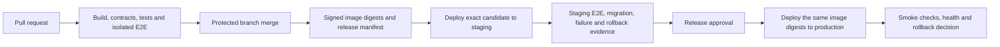

# CI/CD and Release Gates

The delivery path separates application builds, environment access, verification, and promotion. Use the current repository provider when confirmed. GitHub Actions is the reference implementation if the source is hosted on GitHub. Equivalent CI systems must enforce the same separation and evidence.

## Pipeline contract

| Gate | Trigger | Mandatory jobs | Output or stop condition |
| --- | --- | --- | --- |
| G1 Pull request | Changed application, contract, data migration, deployment or spec | Format/lint, compile, unit tests, OpenAPI compatibility, web API client checks, browser smoke, migrations from supported prior schema, dependency/secret checks and impacted feature acceptance | Required checks and addressed review. Failed or missing required jobs block merge. |
| G2 Candidate build | Protected main/tag | Build the web, service and migration images once. Test, scan, record SBOM and provenance, sign OCI digests and produce the combined release manifest. | Signed immutable artifact set mapped to each repository commit, build ID, schema range and feature IDs |
| G3 Staging deploy | Candidate selected | Lock staging, verify environment and signature, take required pre-migration backup, apply expand migrations once, deploy by digest, check readiness and storage/identity access | Verified versions and migration outcome. Stop on an incompatible schema or a failed readiness check. |
| G4 Staging acceptance | Staging deployment ready | Run employee and guest journeys with required browser coverage, including a full approval chain and approved-only guest delivery. Validate the intended primary profile with session, transfer, mail, ingress, upgrade/rollback and restore cases as applicable. | Evidence keyed to profile, stage, manifest digest, suite version and feature IDs. Superseded evidence cannot approve a new release. |
| G5 Production promotion | Exact candidate accepted and production change approved | Verify evidence for selected primary profile, record rollout target, check backups and compatibility, lock environment, acquire scoped deployment identity, and promote that manifest by digest | Named approval, profile, change ticket, deployer identity, exact artifacts, migrations and rollout status |
| G6 Production verification | Release finishes | Run read-only health checks, version and approved canary checks, watch error rates, permissions and worker lag for 30 minutes, and decide continuation or rollback | Update known-good release record and attach telemetry. Stop rollout for unauthorized exposure, wrong target, corrupt data or failed critical canary. |

Keep an approval identity independent of the change author where the provider supports that control. Use protected branches, restricted targets, and least privilege. Keep untrusted PR code on isolated runners. Stage and production deployment identities each have an explicit environment policy and separate runner or pull-based execution. On GitHub, use protected environments and deployment concurrency groups, with cancel-in-progress disabled for an active deploy. Verify plan support. If native protection is unavailable, enforce approval through an auditable deployment controller that alone holds target credentials. Use short-lived OIDC where the destination supports it. [GitHub deployment environments](https://docs.github.com/en/actions/how-tos/deploy/configure-and-manage-deployments/manage-environments), [GitHub Actions OIDC](https://docs.github.com/en/actions/concepts/security/openid-connect).

## Implementation handoff

Create workflows for `pr-verify`, `build-release`, `deploy-staging`, and `promote-production`. Use explicit, repository-owned entry points for unit/contract checks, fixture seeding, spec-case execution, migrations, rollout, smoke and rollback. Actual workflow syntax depends on the repository, build system, registry and runner network. Link each changed spec ID and acceptance-case ID in the pull request and store its machine-readable results.

The manifest records release ID, both source commits, web and backend OCI digests, migrator digest, API contract hash, compatible schema versions, configuration version, SBOM/provenance references and signatures. Deploy the staged image set unchanged by digest. Apply destination-specific runtime settings for hostnames, selected account mode, SSO redirects where configured, cookies, object origins and secrets. Verify those settings and both browser entry points before marking production healthy.

## Database changes and rollback

- Rehearse production-shaped upgrades in staging. Serialize migration execution per environment and service. Migrate using a dedicated role, schema lock, retry/timeout policy and an observable job result. Keep expand migrations compatible with both current and previous application versions.
- Stop on a failed migration or known-incompatible manifest. Restore or repair only from the operator-approved plan for that migration. Repoint application traffic to a known-good digest only when the current database schema remains compatible. Plan forward repair for irreversible changes and document the point when restoration would discard newer writes.
- For low-traffic sites, judge rollout against absolute critical failures and minimum request counts. As starting criteria, alert on five attributable errors and a 5xx rate above 2% over ten minutes, any failed invited-guest canary, or a five-minute scan backlog. Investigate scope before automatic rollback. For security exposure or data corruption, fence affected writes and escalate immediately.
- Emergency production changes need a recorded incident, named authorization, same-artifact verification as far as feasible, rollback plan, and follow-up reconciliation into staging and source control. The emergency route addresses live repair while the normal feature release path uses the gates above.

See [production to staging](01-production-to-staging.md) and the [feature verification matrix](05-feature-verification.md).
